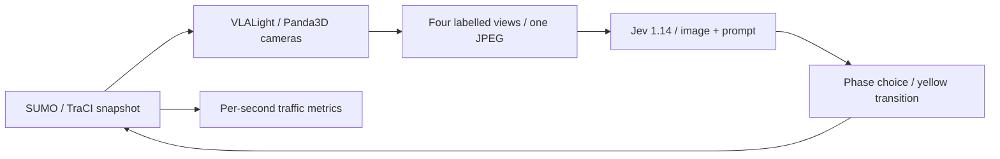

# JevLight

Visual JevLight experiments (official API, WeMM-JEV, d3-turbo and Amos 1 Large):
see the [Vision setup and experiment guide](docs/vision.md).

Traffic signal control with **Jev**, the System One decision model — applied to SUMO simulation on top of the observation and control-flow conventions of **LLMLight / CoLLMLight**.

Jev is not a chat model: one request sends a **state** plus a map of typed **questions**, and returns one typed answer per question, evaluated in parallel. JevLight maps signal control directly onto that interface: the model picks an action from the options you give it. The default path uses structured traffic observations; the optional experimental image path uses camera images and a prompt.

## How signal control maps onto Jev

| Traffic control concept | Jev API concept |
| --- | --- |
| One intersection's snapshot (queue, approaching vehicles by segment, waiting times) | `state` (JSON) |
| "Which phase next?" — ETWT / NTST / ELWL / NLSL | one `choice` question, criteria = the phases |
| "Is this junction congested?" (logged for analysis) | optional `noul` question for local-mode logging |
| Chosen phase + full distribution + confidence | `answers.<id>.choice` / `.probabilities` / `.confidence` |

**Per-intersection packaging** (default): each active junction receives one request with one phase question. CoJevLight includes only the target's current state and its direct upstream/downstream neighbours; JevLight uses the target's local state. CoJevLight rejects `--packaging network`. Empty junctions use local ranking without a model request, while their current states remain available to neighbouring targets.

The default text path follows the ChatLight source conventions:

- Empty junctions (no vehicles) never call the API; they use the exact CoLLMLight local waiting-time ranking.
- Failed / rate-limited / unparsable requests keep the previous signal (`--fallback previous`, default) or use the local ranking (`--fallback ranking`).
- Answers with `confidence < --min_confidence` are rejected the same way.

## Repository layout

All models share the same controller and experiment entry point. Model-specific encoding, decision heads and batching live in `jevlight/backends/`; experiment tools call the core. See [experiment settings](docs/experiment_settings.md).

```
run_jevlight.py            # experiment entry point (mirrors run_LLMLight.py)
baselines/                 # baseline methods (own entry point, shared evaluation stack)
jevlight/
  backends/              # native model adapters, inference engines and batch kernels
  controller.py            # JevLightController, state + question construction
  jev_client.py            # Jev API client: MCP, official TypeSafe, or local
  local_server.py          # local /v1/systemone service (vLLM logit readout, mock)
  observation.py           # SUMO snapshot -> observations (LLMLight semantics)
  env_bridge.py            # minimal SUMOEnv setup (ChatLight InteractionEnv core)
  config.py                # env config + dataset registry
  evaluation_metrics.py    # canonical metrics (from ChatLight)
  rolling_evaluation.py    # hourly/final rolling recorder (from ChatLight)
  wandb_utils.py           # optional W&B logging
scripts/experiments/      # request fixtures, validation helpers and batch runner
scripts/model_downloads/  # per-model downloads and isolated author environments
config/                   # serving, smoke and formal run configuration
results/                  # ignored results, logs and evidence
.local/                   # ignored weights, caches and author sources
scripts/serve_jev.sh       # start a local Jev-style model service (vLLM/mock)
scripts/serve_3d.py        # 3D SUMO visualizer bridge (traci -> SSE)
jevlight/viz_server.py     # visualizer server core (standalone + --visualize)
viz/                       # three.js frontend for the 3D visualizer
jevlight/images.py         # synchronized headless camera capture for image decisions
utils/
  sumo_env.py              # SUMO runtime (from ChatLight, profiling hook stubbed)
  phase_utils.py           # phase helpers (from ChatLight)
data/Jinan/3_4/            # one SUMO scenario (12 intersections)
tests/                     # unit tests (no network, no SUMO)
```

## Setup

Requirements: Python 3.11+, [SUMO](https://sumo.dlr.de) ≥ 1.20 with `traci` / `sumolib` on `PYTHONPATH` or installed via pip (`eclipse-sumo`), plus the Python dependencies:

```bash
uv sync --locked --extra sumo
export SUMO_HOME=/path/to/sumo   # if traci/sumolib are not pip-installed
```

## Experiment configuration

Use `uv` for the project environment and run experiments through `run_jevlight.py`. Parameters live in `config/<model>/<experiment>.json`; command-line flags override file values.

```bash
# Inspect parameters without starting SUMO or calling an API
uv run python run_jevlight.py --config config/jev/jinan_smoke.json --print_config

# Run a short mock experiment with the SUMO runtime
uv run --extra sumo python run_jevlight.py --config config/jev/jinan_smoke.json
```

See [config/README.md](config/README.md) for examples. Results, downloaded weights, author sources and local environments are ignored by Git. Completed trajectory files can be compressed with the optional [trajectory archiver](docs/trajectory_compression.md).


## Native decision models and batch inference

The frozen catalog in `scripts/model_downloads/models.json` includes 21 checkpoints across Laya, GLiNER2.5-Decide, Agent-Jev, Kev, Decider, Von, Clef, Bespoke-Nimble, Valen, Lev and Open-Jev. Each checkpoint has a `config/<model>/serving.toml` and per-model download entry point. See [model preparation](scripts/model_downloads/README.md).

Prepare the model, start its service, then run a selected experiment. The example
below uses Laya; consult the [environment and runtime table](scripts/model_downloads/README.md#serving-and-validation)
for the other checkpoints.

```bash
# Prepare weights, complete backbones, pinned author sources and dependencies
uv sync --locked --extra sumo --extra preparation
uv run --locked --extra preparation python scripts/model_downloads/download.py --models laya
uv run --locked python scripts/model_downloads/fetch_sources.py
uv sync --locked --project scripts/model_downloads/environments/encoder

# Keep the model service running in this terminal
uv run --locked --project scripts/model_downloads/environments/encoder \
  python -m scripts.experiments.serve_decision_model \
  --config config/laya/serving.toml --request-log results/laya/requests.jsonl \
  --batch-runtime native
```

`config/<model>/serving.toml` holds `weights_path`, backend settings and the service
port. The downloader creates the snapshot manifests needed to resolve complete
backbones. For existing downloads, preserve that layout and update the weight and
backbone paths; a bare checkpoint folder may not contain everything the adapter needs.

In another terminal, inspect the final parameters and run the experiment:

```bash
uv run --locked python run_jevlight.py \
  --config config/laya/jevlight_jinan-1_s1.json --jev_batch_size 196 --print_config

uv run --locked --extra sumo python run_jevlight.py \
  --config config/laya/jevlight_jinan-1_s1.json --jev_batch_size 196
```

The experiment JSON selects the traffic scenario, ordinary/Co mode, seed and service
URL (`jev_base_url`). Match that URL to the running service. `run_jevlight.py` connects
to the service; it does not load weights or launch the model server. Select a
`cojevlight_*.json` configuration to run the corresponding cooperative condition.

Set `jev_batch_size` in the JSON or pass it on the command line to enable batching;
it defaults to zero when omitted. The value 196 covers the largest bundled network.
Each active intersection retains its complete independent request; the backend
reduces GPU chunk capacity when memory is insufficient, and actions are applied
after all answers arrive. The optional `python -m scripts.experiments.step_batch_runner`
entry point invokes the same runner with extended batch error diagnostics.

Optional engine adapters retain the author's decision head and full token encoding.
Their dependencies, CUDA ABI, memory budget and capacity must match the deployment.
CPU tests check structure and mapping; actual speed and GPU/SUMO compatibility must
be established on the selected device before collecting comparable measurements.

## API keys

Three transports are supported:

| Transport | Endpoint | Key |
| --- | --- | --- |
| `mcp` (default) | Jev community server `https://www.jevai.org/api/mcp`, tool `jev_decide` | `$JEV_API_KEY` (`jev_...`) |
| `official` | TypeSafe `POST https://api.typesafe.ai/v1/systemone` | `$TYPESAFE_API_KEY` |
| `local` | self-hosted Jev-compatible server (`$JEV_LOCAL_BASE_URL`, default `http://127.0.0.1:8123`) | none |

All transports answer the same `state` + typed `questions` request. The optional
[API key pool and experiment queue](docs/jev_api_experiments.md) support ordered
credential rotation on HTTP 402 and resumable API experiments.

## Experimental image decisions (Jev 1.14)

TypeSafe's [image API](https://docs.typesafe.ai/images) accepts an image plus
instructions and returns the same typed `choice` answer. This path uses **one
direct decision per intersection**, with no separate perception model, fast/slow
reasoning, or VLALight training code. The default model is pinned to
`jev-1.14.0`; a versioned ID avoids changes to the `jev-preview`/`jev-latest`
aliases during an experiment.

```bash
pip install -r requirements-images.txt
python -m playwright install chromium
export TYPESAFE_API_KEY=...
python run_jevlight.py --jev_transport official --image_decisions \
  --dataset jinan --count 900

# Capture + control-loop smoke test, without an API key or vision inference:
python run_jevlight.py --jev_transport official --image_decisions \
  --mock_jev --count 30
```

`--image_prompt "Prioritize visible spillback"` appends task instructions to
the camera/phase prompt. Image mode selects `jevlight`, `per_intersection`
packaging and `previous` fallback, and omits the speculative congestion question.
Explicit network packaging, ranking fallback and `--dry_run` are rejected.
The MCP endpoint and the repository's text-only local adapter have no image
support in this implementation.

At each control boundary, SUMO stays paused while its **current** vehicle
positions and signals populate the existing Three.js scene in headless Chromium.
Each junction produces a 1024×768 JPEG with four approach views labelled by
vehicle travel direction. The renderer currently requires four approaches, as in
the supplied grid datasets. It uses the visualizer's CDN imports, so Chromium
must be able to reach `unpkg.com` when starting a run.

Only the image, junction ID, current phase, control interval and phase criteria
reach Jev. Queue counts, waiting times, occupancy, and neighboring state are not
included. Empty junctions also receive image decisions. API errors, invalid
choices and low confidence keep the previous phase; a rendering failure stops
the run. `--mock_jev` chooses the first allowed phase and is **not a vision
benchmark**.

The HTTP client uses the documented multipart protocol: JSON `request` first,
an `assets` map referring to JPEG/PNG file parts, and the explicit
`TypeSafe-Danger-Zone-Images: true` header. Images bypass the optional SDK so
older SDK versions cannot silently discard assets. File format, dimensions,
references and upload size are checked before sending. The experiment saves
the exact frames under `records/<memo>/<run>/vision_frames/` and records their
paths, prompt, answer, confidence, fallback, tokens and request latency in
`jev_decisions.jsonl`. Summary files distinguish image/text and mock runs.
Frame retention is opt-in: the default keeps every frame, which is a few
hundred megabytes per junction-hour (a 16-junction, six-hour seed writes about
92,000 JPEGs), so pass `--keep_frames 0` to delete each frame once its decision
completed or `--keep_frames N` to keep only the N newest per junction.

For an already captured image, the low-level API is also available:

```python
from pathlib import Path
from uuid import uuid4
from jevlight.jev_client import JevClient

ref = str(uuid4())
client = JevClient(transport="official", model="jev-1.14.0")
result = client.evaluate(
    state={"camera_image": ref},
    questions={"phase": {"type": "choice",
        "instructions": "Use camera_image to choose the next traffic phase.",
        "criteria": {"ETWT": "east/west through", "NTST": "north/south through"}}},
    assets={ref: Path("camera.jpg")},
)
```

Images are an opt-in **Danger Zone** experiment, not a production feature.
[Box](https://docs.typesafe.ai/primitives/box) localizes objects; it is unnecessary
for choosing a signal phase. The separate 262k-context feature is also unnecessary
here, so this path does not enable it. See the official
[release notes](https://typesafe.ai/blog/jev-1-14) and
[model limits](https://docs.typesafe.ai/models).

Community-endpoint notes (observed behavior):

- Do not pass `--jev_model` with official aliases such as `jev-latest`; the endpoint expects identifiers like `typesafe-ai/jev`. By default the model field is omitted so the server chooses.
- The free endpoint enforces a burst quota and returns transient upstream failures under load. The client retries those with exponential backoff and paces requests (`--jev_min_interval`, default 3s for `mcp`); steps that still fail fall back per `--fallback`, and each decision trace records whether it was a real Jev answer or a fallback.

## Open-source Jev-style models (local transport)

Jev itself is closed, but the open System One ecosystem (Laya, Tev1, Von, Jebadiah, …) converges on Jev's wire format: a local server exposing `POST /v1/systemone`. The `local` transport talks to any of them — no API key, no request pacing.

This repo ships a serving stack of its own, `scripts/serve_jev.sh`:

```bash
# 1) GPU-free pipeline smoke test: /v1/systemone with deterministic
#    max-pressure answers (same semantics as --mock_jev):
scripts/serve_jev.sh --backend mock

# 2) Open checkpoint on vLLM (the "Jev-vLLM" route), e.g. Tev1:
scripts/serve_jev.sh --model tev1                    # alias -> HF repo id
scripts/serve_jev.sh --model <org>/<checkpoint>      # any HF causal LM
#    or point the adapter at an already-running OpenAI-compatible endpoint:
python -m jevlight.local_server --backend vllm \
    --vllm_base_url http://gpu-host:8000/v1 --vllm_model <name>
```

The vLLM route deploys two layers: vLLM serves the checkpoint on an OpenAI-compatible endpoint, and `jevlight.local_server` adapts it to `/v1/systemone` — each question becomes one letter-labelled prompt and the option probabilities are read from next-token logprobs in a single prefill (no decoding, millisecond-scale decisions). Then run JevLight against it:

```bash
uv run python run_jevlight.py --jev_transport local --dataset jinan --count 900
```

Any *other* Jev-compatible server works too — start it on port 8123 (or set `--jev_base_url` / `$JEV_LOCAL_BASE_URL`) and the `local` transport talks to it directly.

Caveats, stated plainly: logit-readout probabilities from a general open checkpoint are **uncalibrated** — they are model scores, not Jev's calibrated confidence. Compare models on `jev_decisions.jsonl` traces and canonical metrics, and keep `--fallback` enabled.

## Agent modes

`--agent` selects the prompt wording and request pattern on the same Jev interface — the two migrated ChatLight baselines with Jev as the decision model:

| Mode | Prompt | Packaging | Congestion Noul |
| --- | --- | --- | --- |
| `jevlight` | JevLight: one agent per intersection, local view only (LLMLight pattern) | per_intersection | optional (off by default) |
| `cojevlight` (default) | CoJevLight: one agent per intersection with direct upstream/downstream context | per_intersection | optional (off by default) |

```bash
uv run python run_jevlight.py --agent jevlight   # per-intersection agent
uv run python run_jevlight.py --agent cojevlight # target and direct neighbours (default)
```

The pre-release names `llmlight` / `collmlight` remain accepted as aliases. CoJevLight requires `per_intersection` packaging. Both modes send only the phase question by default (`speculative=false`). Use `--speculative` or JSON `"speculative": true` to add a congestion `noul` question in the same request; `--speculative false` disables it. The old `no_speculative` option is removed. The optional answer is logged and is not used to select the signal; each decision trace records the active `agent_mode`.

Movement codes follow LLMTSCS: N/S/E/W name the **incoming side**, not the
vehicle's heading. NT goes north → south, ST south → north, ET east → west,
and WT west → east. On a regular intersection, left turns NL/SL/EL/WL go
toward east/west/south/north respectively. Phase criteria name the actual
available movement pairs; their action indices are not swapped.

CoJevLight learns direct lane relations from observed vehicle transitions between
junctions. Straight and left-turn movements contribute to these relations;
ambiguous movements and transitions across right turns are excluded. The
cooperative view includes current occupied neighbour lanes whose learned share
exceeds 5%, grouped under each nonempty target lane. It does not expand neighbours
recursively. Vehicle IDs and accumulated transition counts stay local; model
requests contain current states, without previous observations or actions.

The target retains its local waiting-time ranking as an advisory input. Ordinary
JevLight uses local pressure and traffic state without neighbour information.
Both modes preserve the same candidates, yellow-time handling and fallback
rules. See [cooperative lane context](docs/cojevlight_related_lane_context.md)
for the state fields and relation rules. Full requests must fit the model's native
encoding and context limits without truncation.

## 3D visualization (SUMO)

`scripts/serve_3d.py` runs (or attaches to) a SUMO simulation and streams it to a city-scale 3D viewer (three.js, no build step): asphalt lanes with sidewalks, dashed lane markings, stop lines and zebra crossings, procedural street buildings with sun and soft shadows, vehicle models by SUMO vehicle class (car / bus / truck / two-wheeler, colored per vehicle), traffic-light heads, and play/pause/step/speed controls:

```bash
python scripts/serve_3d.py                    # Jinan at 1x, open http://127.0.0.1:8300
python scripts/serve_3d.py --speed 4          # 4x playback
python scripts/serve_3d.py --attach 127.0.0.1:8813   # watch an already-running SUMO
python scripts/serve_3d.py --sumo_args "--seed 3"    # extra SUMO flags
```

**Traffic-camera mode**: click `📹 Cam` (or 🎲) to install a virtual surveillance camera at a random junction, or click any junction in the camera list to switch. The page then shows a 2×2 grid of live views — one per approach direction (北/东/南/西 labeled) — rendered from pole-mounted cameras at that intersection, with a pole marker visible in the main 3D view.

Architecture: one thread owns the traci connection (vehicle subscriptions + TLS states per step) and publishes snapshots; browsers get the network once via `GET /api/network` and per-step frames over SSE (`GET /api/stream`); `POST /api/command` drives play/pause/step/speed. traci positions are shifted into net coordinates so vehicles and lane geometry share one frame. On a remote server, port-forward with `ssh -L 8300:127.0.0.1:8300`; the page needs internet access once to load three.js from the CDN (or vendor `three.module.js` into `viz/js/` and drop the import map).

### Visualizing a JevLight experiment

`run_jevlight.py --visualize` attaches the same viewer to the run's own simulation — no separate SUMO, one frame per control step of the actual experiment, and the page's play/pause/step buttons gate the experiment loop itself:

```bash
uv run python run_jevlight.py --mock_jev --count 60 --visualize          # opens the browser
uv run python run_jevlight.py --jev_transport local --visualize --viz_hold
```

Options: `--viz_host`/`--viz_port` (next free port is picked automatically), `--viz_hold` keeps serving the final 3D state after the run until Ctrl-C. On a headless node the browser cannot open itself — the runner prints the URL plus the matching `ssh -L` forwarding command.

## Usage

```bash
# 1) MaxPressure baseline, no decision model at all (dry run):
uv run python run_jevlight.py --dry_run --count 3600

# 2) Pipeline smoke test, no API key (deterministic mock decisions):
uv run python run_jevlight.py --mock_jev --count 60

# 3) Community MCP endpoint (one request per active junction per step):
export JEV_API_KEY=jev_...
uv run python run_jevlight.py --dataset jinan --count 900

# 4) Official TypeSafe API, confidence-gated fallback to local ranking:
export TYPESAFE_API_KEY=...
uv run python run_jevlight.py --jev_transport official --count 900 \
    --min_confidence 0.5 --fallback ranking

# 5) Open Jev-style model served locally (see the local-transport section):
scripts/serve_jev.sh --model tev1          # start the service first
uv run python run_jevlight.py --jev_transport local --count 900

# 6) Per-intersection (jevlight agent) requests + rolling evaluation:
uv run python run_jevlight.py --agent jevlight --count 3600 --rolling_evaluation
```

`--dry_run` swaps the controller for a classic **MaxPressure** agent: each intersection activates the phase whose lanes hold the most vehicles (queued + approaching — the same pressure the mock Jev scores), entirely local, zero Jev requests, no key or transport needed. Traces record the per-phase pressures, and `summary.json` carries `"dry_run": true` with zero Jev usage — a standalone baseline for a separately authorized later task. Model campaign queues neither run nor depend on MaxPressure. The `baselines/` package ships a second, formula-different MaxPressure variant (upstream-minus-downstream lane pressure) — see the [Baselines](#baselines) section for the distinction.

Each run writes `results/<model>/<memo>/<run_id>/` (CLI-only runs default to `results/jev/JevLight/<run_id>/`):

- `jev_decisions.jsonl` — one trace per decision: question, answer, probabilities, confidence, latency, token usage, fallback reason
- `summary.json` — final metrics + aggregate Jev usage stats
- `experiment_config.json` — resolved experiment parameters, excluding API credentials
- plus SUMO's own logs via `batch_log()`

## Baselines

The `baselines/` package runs classic baseline methods on JevLight's evaluation stack: **LLMLight** and **CoLLMLight** (LLM, inference-time control), **CoLight**, **PressLight**, **MPLight**, **AttendLight**, **AdvancedDQN** (TensorFlow RL), **CityLight** (PyTorch MAPPO), **MaxPressure** (strict lane-pressure formula; not the `run_jevlight.py --dry_run` MaxPressure the benchmark uses as its reference line, and published separately as "MaxPressure (strict)"), **Webster**, and **FixedTime**. They run through their own entry point, `python -m baselines.run_baseline`, which reuses the same `SUMOEnv`, observation collector, and metric computation unchanged and mirrors `run_jevlight.py`'s control loop (a drift-guard test pins the mirrored configuration to it). Results land in `results/<baseline>/<memo>/<run_id>/` with the same `summary.json` / `jev_decisions.jsonl` layout, so baseline numbers are directly comparable with Jev/CoJev runs; `run_jevlight.py` itself is not modified.

```bash
# Heuristic baselines (SUMO only, no decision model, no extra dependencies):
uv run --extra sumo python -m baselines.run_baseline --baseline fixedtime --count 3600
uv run --extra sumo python -m baselines.run_baseline --baseline maxpressure --count 3600
uv run --extra sumo python -m baselines.run_baseline --baseline webster --count 3600

# LLM baselines against a served checkpoint; the deterministic mock needs no server:
uv run --extra sumo python -m baselines.run_baseline --baseline llmlight --mock_llm --count 60
uv run --extra sumo python -m baselines.run_baseline --baseline collmlight --mock_llm --count 60

# RL baselines: train first, then evaluate the checkpoint through the same flow:
uv run --extra sumo --extra baselines-rl python -m baselines.rl.train \
    --model Colight --dataset jinan --count 3600 --num_rounds 50
uv run --extra sumo --extra baselines-rl python -m baselines.run_baseline \
    --baseline colight --rl_checkpoint model/Colight/<traffic>_<ts> --count 3600
```

Shared arguments mirror `run_jevlight.py` (`--dataset`, `--traffic_file`, `--duration`, `--count`, `--seed`, `--eightphase`, `--rolling_evaluation`, …); experiment configs live in `baselines/config/<baseline>/<experiment>.json`. The runner supports neither `--visualize` nor checkpoint resume. Dependencies: the heuristic baselines need nothing beyond the core project, the generic LLM path needs the `baselines-llm` extra, the five TensorFlow RL models need `baselines-rl`, and CityLight needs `baselines-rl-torch` (an umbrella `baselines` extra installs all three). See [baselines/README.md](baselines/README.md) for the LLM endpoint configuration, RL checkpoint layout, and implementation notes — including the MaxPressure naming note: `run_jevlight.py --dry_run` groups under `results/maxpressure/` too, but scores own-lane queued + approaching vehicles, while the baseline scores upstream minus downstream queues.

## Datasets

Four SUMO scenarios ship with the repo (selected with `--dataset`, traffic file with `--traffic_file`; see `jevlight/config.py` for the registry):

| Dataset key | Network | Intersections | Traffic files |
| --- | --- | --- | --- |
| `jinan` | 3×4 | 12 | real, real_2000, real_2500, synthetic_24h_6000 |
| `hangzhou` | 4×4 | 16 | real, real_5816, synthetic_24000_60min |
| `newyork` | 28×7 | 196 | real_double, real_triple |
| `newyork_16x3` | 16×3 | 48 | real |

MZW and Manhattan are not included; copy them from the upstream project's `data/` and register them in `jevlight/config.py` if needed. Published SUMO benchmark results are available on the project homepage, with data in `assets/benchmark.json`. That file is generated, not hand-edited: `python scripts/benchmark/build_benchmark.py --write` rebuilds it from the formal experiment records (mean and sample standard deviation across the three seeds, per traffic flow and mode).

The homepage also publishes a composite index over those results, plus a score-vs-compute plane. Both are derived, never hand-edited:

```bash
# 1) Serving telemetry, run where the experiment records live:
python scripts/benchmark/collect_telemetry.py \
    --records results/experiments/records \
    --legacy-csv results/decision_models/2a800/experiment_records.csv \
    --benchmark assets/benchmark.json --results-root results \
    --out assets/telemetry.json

# 2) Composite index + cost plane (writes assets/composite.json and .js):
python scripts/benchmark/build_composite.py
```

`collect_telemetry.py` reads only aggregates out of each run's `jev_decisions.jsonl` (decision count, tokens, and the per-step maximum request latency), and can recover the runs behind a published aggregate by matching its metric fingerprint when a run directory has no record file. `build_composite.py` normalises every (scene, metric) cell with a log min-max across the whole published pool, averages the 21 cells into one score, and derives cost as serving time × GPUs held. Sources live in `assets/benchmark.json` and `assets/telemetry.json`; the page reads the generated files through `assets/composite.js`.

## VLALight cameras + direct Jev decisions

`--image_renderer vlalight` reuses [VLALight](https://github.com/usail-hkust/VLALight)'s
TransSimHub/Panda3D renderer and its scenario GLB assets. Source and assets are
pinned to `9844f1b6bbd6b4fe80b481d3dd16fadce13c3b5d`; the fetch script verifies
each file against its Git blob hash. The SUMO controller and metric recorder
remain JevLight's. This is a rendering integration, with one direct Jev choice
per intersection; VLALight's video/perception agents and fast/slow reasoning
stages are not part of this path.

At each control boundary SUMO pauses while the adapter copies current vehicle
poses into the renderer. Four 30 m approach cameras render at 1080P. Each view
uses VLALight's horizontal crop (40% from the left, 30% from the right), is
resized to 384 x 720 and labelled with vehicle travel direction. The four views
form one 768 x 1440 JPEG. Camera batches reuse GPU resources; an explicit GPU
synchronization precedes pixel readback. Rendering does not advance SUMO or
replace its TraCI subscriptions.

The official TypeSafe multipart API receives that image, current phase and one
traffic-control prompt. It returns a phase choice, applied for a 15-second
interval including five seconds of yellow when changing phase. Numeric queue,
occupancy and waiting-time observations are not sent to Jev. Image requests
explicitly opt into the [experimental Images API](https://docs.typesafe.ai/images).



Install SUMO, Python requirements and GitHub CLI (`gh`) first. This optional
renderer needs a working OpenGL graphics context; the local checks used Windows.
The existing browser viewer (`--visualize`) continues to use Three.js.

```bash
python scripts/fetch_vlalight_renderer.py
pip install -r requirements-vlalight.txt
# Four networks, 30 seconds each; mock decisions only, no model score:
python scripts/benchmark_vlalight_jev.py --method smoke --seeds 1 --execute
# All ten available route files, seeds 1/2/3; no API:
python scripts/benchmark_vlalight_jev.py --method maxpressure --execute --workers 2
# Save the full Jev plan without making requests:
python scripts/benchmark_vlalight_jev.py --method jev-image
```

For actual Jev evaluation, set `TYPESAFE_API_KEY` in the same terminal
(PowerShell: `$env:TYPESAFE_API_KEY = "your-key"`; Bash:
`export TYPESAFE_API_KEY="your-key"`), then run:

```bash
python scripts/benchmark_vlalight_jev.py --method jev-image --execute
```

### Vision benchmark status

This directory contains the Vision API and VLALight evaluation code. Generated
SUMO traces, API responses, logs and score tables are deliberately left out of
git: they land in `records/<memo>/<run>/` (`summary.json`, `jev_decisions.jsonl`,
`vision_frames/`), which is ignored. The camera-decision numbers are reported
from those local artifacts and are not published to this README.

The Vision path is a direct image decision test: the existing VLALight renderer
creates the camera image, Jev receives that image and the traffic-control prompt,
and the returned phase choice is applied in SUMO. It does not add VLALight's
fast/slow reasoning or perception agent. Results will be reported separately
from the historical text-only JevLight benchmark.

The full Jev matrix requires approximately **608,160 image requests before
retries**, with the model pinned to `jev-1.14.0`. Runs execute serially; each
control boundary can issue up to eight concurrent intersection requests. Add
`--datasets jinan --seeds 1` for an initial subset, or `--resume` to reuse
completed runs with matching data, method, model and renderer revision. Failed
or fallback image decisions stop that run and cannot enter the score table.
Mock checks are labelled `smoke_only` and excluded from aggregates.

On Windows, resume the full local job with:

```powershell
powershell -NoProfile -ExecutionPolicy Bypass -File scripts/run_vlalight_benchmark.ps1
```

The launcher reads the user-level `TYPESAFE_API_KEY`, prevents duplicate jobs,
and writes a heartbeat every 30 seconds to `logs/jev_full_job_status.json`.
Timestamped logs are kept in `logs/benchmark_jobs/`. It checks the real image
API before starting SUMO; an unavailable API stops the job and preserves existing
scores. Transient connection errors allow eight retries with exponential delay
capped at 30 seconds; permanent HTTP rejections such as 401/403/451 stop retries.
Completed seeds are reused; an unfinished seed restarts from its beginning,
since this path does not save SUMO state checkpoints. A successful full matrix
is committed locally on `local/jev-vlalight-benchmark`, without a push or PR.

Per-seed measurements and the evaluation protocol live in the run's own
`summary.json` and `jev_decisions.jsonl` together with the dataset and roadnet
hashes; they are not committed because `records/` is gitignored. Only completed
real Jev seeds enter the score table; short API preflights are kept separate
from model scores. The fixed horizon covers departures without clearing the
network; unfinished trips and teleports must be considered alongside travel
time. These SUMO results are separate from the historical CityFlow numbers.

## Tests

```bash
python -m pytest tests/ -q
```

## Provenance

The observation semantics (`collect_observations`), the local phase ranking (`rank_phases`), the SUMO runtime, the metrics, and the runner's control loop come from ChatLight's migrated LLMLight / CoLLMLight inference paths; Jev replaces the text-completion LLM as the decision model.
